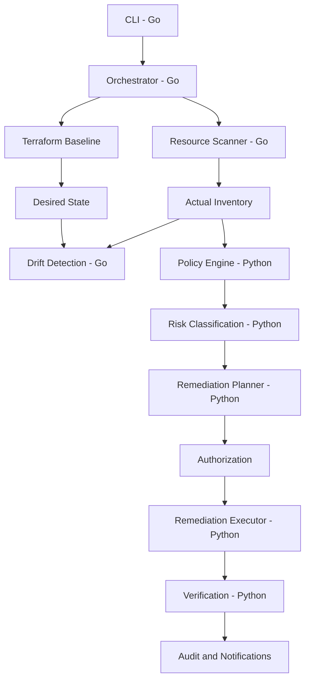

# CloudGuard

> Automated cloud drift detection and compliance remediation for AWS.

**Status: Phase 0, engineering foundation. Nothing below is implemented yet unless the Status table says so.**

---

## Problem Statement

Teams deploy cloud infrastructure with Infrastructure as Code (IaC), then someone changes it through the console, an API call, or another automation. The running infrastructure no longer matches the code, and the change may open a security hole (for example, a public S3 bucket). Pre-deployment IaC scanners cannot see this, because they only read code, not what is actually running.

CloudGuard continuously:

1. **Discovers** what actually exists in AWS (read-only).
2. **Detects drift** against the intended state defined in Terraform.
3. **Evaluates compliance** with policy-as-code.
4. **Proposes remediation** without changing anything.
5. **Executes only authorized fixes**, then **independently verifies** the result.
6. **Records an audit trail** of every important action.

**Key idea:** drift and security violations are different things. A difference from Terraform is not automatically a vulnerability, and a vulnerability is not always drift. CloudGuard keeps these two capabilities separate.

## Status

| Capability | Status |
|---|---|
| Repository foundation | In progress |
| Go CLI skeleton (`version` command, exit-code contract) | Implemented (local tests only; CI comes in a later branch) |
| Python package skeleton (`--version`, exit-code contract) | Implemented (local tests only; CI comes in a later branch) |
| Shared JSON schemas | Planned |
| AWS discovery (S3, EC2, IAM, CloudTrail) | Planned |
| Terraform drift detection | Planned |
| Policy engine | Planned |
| Remediation and verification | Planned |

## Architecture

CloudGuard is a **modular monolith**: one deployable unit, with clear internal boundaries. Detailed design lives in `docs/` as it is written.

### Three execution modes (enforced by AWS IAM, not just application code)

| Mode | AWS permissions | Changes AWS? |
|---|---|---|
| Discovery | Read-only identity | No |
| Evaluation | None needed (works on saved data) | No |
| Remediation | Separate, narrowly scoped identity | Yes, only when authorized |

## Design Decisions

Significant decisions are recorded as Architecture Decision Records in [`docs/adr/`](docs/adr/README.md):

- [ADR-001](docs/adr/0001-modular-monolith.md): Modular monolith architecture
- [ADR-002](docs/adr/0002-go-for-discovery.md): Go for resource discovery
- [ADR-003](docs/adr/0003-python-for-policy-and-remediation.md): Python for policy evaluation and remediation
- [ADR-004](docs/adr/0004-json-schema-contracts.md): JSON Schema for cross-language contracts

## Threat Model

*Planned. See `docs/threat-model/`.*

## Technology Choices

| Layer | Choice | Why |
|---|---|---|
| Discovery, CLI, drift | Go | Fast, simple concurrency, single static binary |
| Policy and remediation | Python | Fast to write, strong validation (Pydantic), boto3 |
| Contracts between them | JSON Schema | Language-neutral, versioned, testable |
| Infrastructure | Terraform | Industry-standard IaC, machine-readable plans |
| CI/CD | GitHub Actions | Native to the repository |

*Tradeoffs for each choice will be documented in the ADRs.*

## Cost Model

| Item | Cost |
|---|---|
| Development and unit tests | $0 (local) |
| Integration tests | $0 (local AWS emulator, to be validated in an ADR) |
| Real-AWS validation | Short burst-deploys in an isolated sandbox account, destroyed afterward |

## Designed & Validated vs Live Demo

- **Designed & Validated (permanent, in this repo):** code, tests, scan output, diagrams, ADRs, threat model.
- **Live Demo (infrastructure torn down after):** recorded runs against a real AWS sandbox.

## Exit-Code Contract (planned)

| Code | Meaning |
|---|---|
| 0 | Success |
| 1 | Operational failure |
| 2 | Invalid configuration or usage |
| 3 | Policy violations detected |
| 4 | Remediation or verification failure |

## Roadmap

- [ ] Phase 0: Engineering foundation
- [ ] Phase 1: Go AWS discovery engine
- [ ] Phase 2: Terraform drift detection
- [ ] Phase 3: Python compliance engine
- [ ] Phase 4: Remediation engine
- [ ] Phase 5: Testbed, Docker, deployment
- [ ] Phase 6: Production hardening
- [ ] Phase 7: Portfolio release

## Out of Scope (initial release)

Azure and GCP, web dashboard, Kubernetes operator, ML risk scoring, multi-tenant SaaS, universal automated rollback.

## Remaining sections (added as each is built)

Deployment Guide · CI/CD · Security Review · Testing Strategy · Monitoring · Incident Runbook · Benchmarks · Demo Video

## License

TBD
